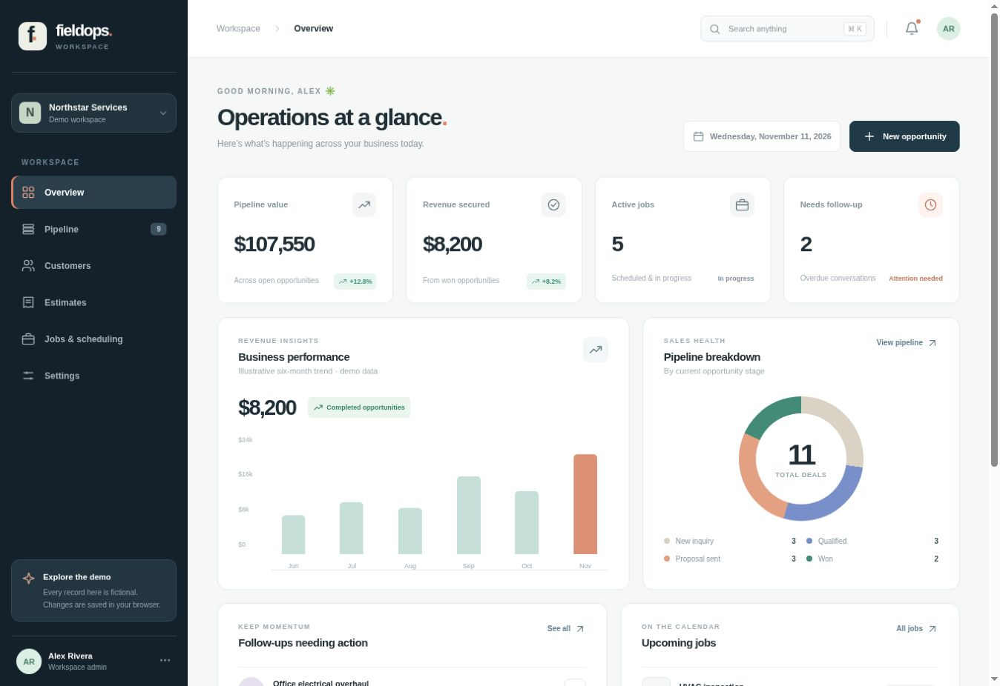
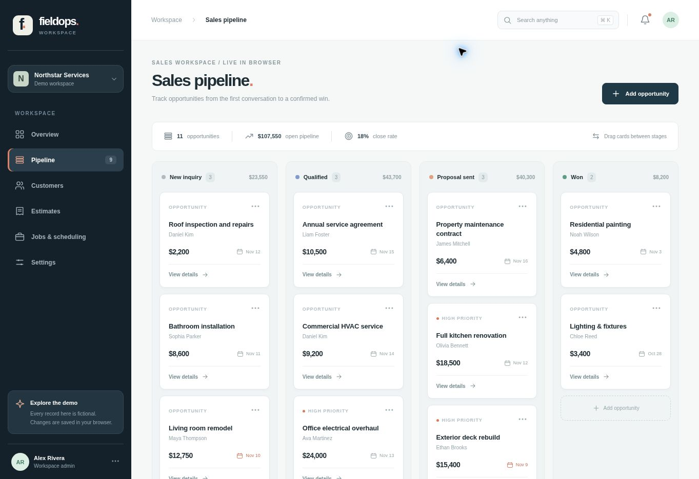
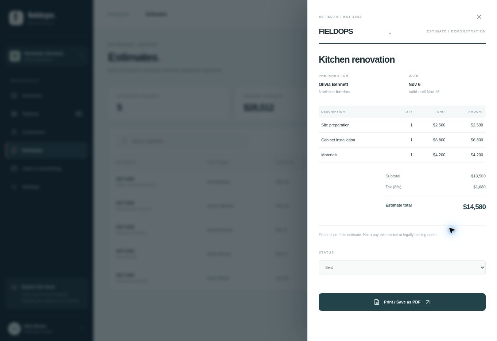
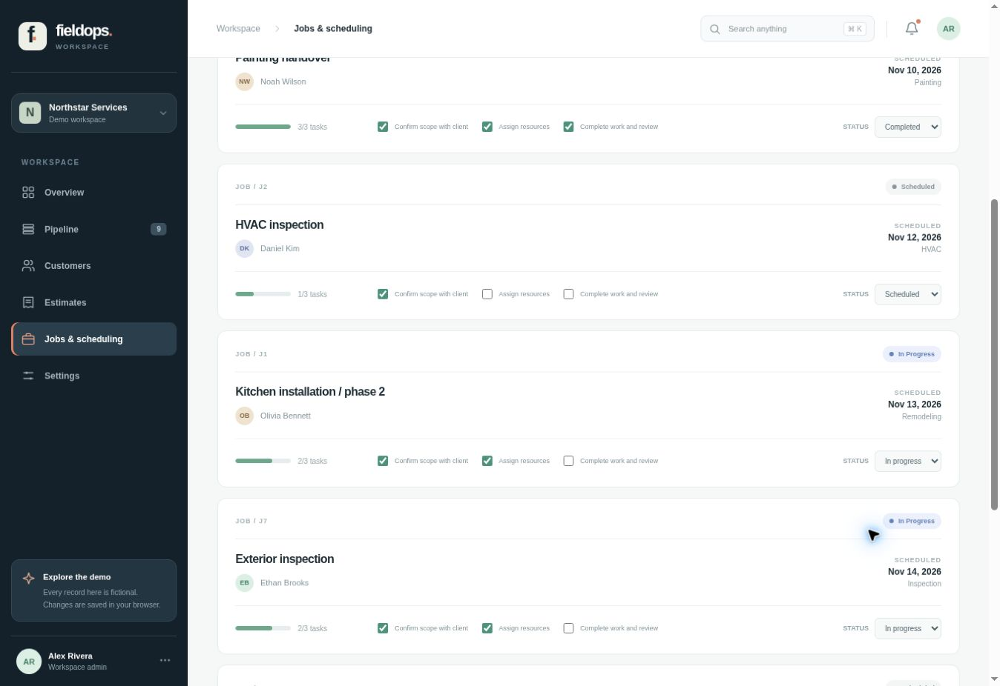
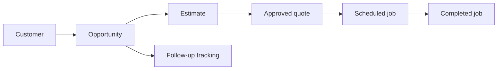

<div align="center">

# FIELDOPS

**A service-business command center, designed for the work behind the work.**

A complete, interactive portfolio case study that combines a sales pipeline, customer directory, itemized estimates, job scheduling and operational reporting in one responsive workspace.

**JavaScript (ES modules)** · **HTML5** · **Modern CSS** · **Node.js** · **GitHub Actions** · **Netlify-ready**

[Live demo](https://fieldops-service-crm.vercel.app/) · [Screenshots](#interface-screenshots) · [Explore features](#at-a-glance) · [Run locally](#getting-started) · [Architecture](#architecture) · [Why this project?](#built-for-a-real-freelance-use-case)

</div>

---

## At a glance

| Area | What you can do |
| --- | --- |
| **Overview** | Monitor open pipeline value, secured revenue, active jobs, overdue follow-ups, and sales stages. |
| **Sales pipeline** | Create opportunities, set follow-up dates, drag cards between stages, and update deals using a detail drawer. |
| **Customers** | Add customers, search contact records, and view linked opportunities and estimates. |
| **Estimates** | Compose itemized quotes with quantity, unit price and tax. View totals, change approval statuses, and print/save as PDF. |
| **Jobs & scheduling** | Schedule work, track three-item checklists, update job status and review upcoming work. |
| **Workspace settings** | Export a JSON backup, reset the demo and understand what is (and isn't) stored. |
| **Experience** | Mobile-responsive layout, keyboard navigation, global search (`⌘K` / `Ctrl+K`), accessible dialogs and status feedback. |

> **Important:** FieldOps is a fully interactive *portfolio demo*, not a deployed multi-user SaaS. Its records are **fictional** and changes persist only in the browser's `localStorage`. It does not send emails, process payments, synchronize data or protect sensitive real customer records. There is no real authentication or server database. The interface openly labels this limitation.

## Interface screenshots

Real screenshots captured from the [live FieldOps demo](https://fieldops-service-crm.vercel.app/) on **November 11, 2026**. All people, companies, amounts and records below are the project's built-in **fictional demo data**. These are captures of the working interface, not mockups.

### Operations overview

Pipeline value, secured revenue, active jobs and follow-up indicators, alongside the demo revenue chart and sales-stage breakdown.



<details>
<summary><strong>Sales pipeline — opportunities by stage</strong></summary>

The Kanban board groups opportunities into new inquiries, qualified leads, proposals and won deals, with values and follow-up dates.



</details>

<details>
<summary><strong>Estimate details — line items, tax and totals</strong></summary>

The estimate drawer shows itemized work, quantities, unit prices, tax and approval status. The browser's print flow provides the PDF export.



</details>

<details>
<summary><strong>Jobs and scheduling — delivery status and checklists</strong></summary>

Scheduled and in-progress jobs display their dates, customers, task progress and status controls.



</details>

[Capture details and reproduction steps](docs/screenshots/README.md).

## Built for a real freelance use case

I researched publicly visible freelance briefs from November 2026 instead of building another generic landing page. In particular:

1. [Custom CRM for a handyman business — Upwork](https://www.upwork.com/freelance-jobs/apply/Custom-CRM-web-app-for-our-handyman-business_~022114438943809880362/): customer records, opportunity → quote → scheduled job → completed workflow, line-item estimates and mobile usage.
2. [CRM development for service businesses — Upwork](https://www.upwork.com/freelance-jobs/apply/CRM-Development_~022098699449606618477/): lead pipelines, customers, estimates, job management, follow-up dates, responsive dashboards and robust tests.
3. [Client Delivery Portal — Upwork](https://www.upwork.com/freelance-jobs/apply/Client-Delivery-Portal_~022102545819845665060/): clear client progress reporting, internal updates and polished usability.
4. [React + Supabase ERP migration — Workana](https://www.workana.com/pt/job/desenvolvedor-react-e-supabase-para-migracao-de-erp-pdv-completo): operational dashboards, customers, inventory, quotes and workflows.

**Project thesis:** small service companies need visibility from initial inquiry through estimate and delivery. FieldOps demonstrates the UI, business logic, data relationships and delivery quality relevant to that class of project — without pretending to be the completed commissioned system from any posting.

## Getting started

Requirements: **Node.js 20 or later**. No third-party runtime or build dependencies.

```bash
git clone https://github.com/fbccsz/fieldops-service-crm.git
cd fieldops-service-crm
npm ci
npm run dev
```

Open **http://localhost:4173**.

### Quality checks

```bash
npm test       # Node.js built-in test runner
npm run build  # produces dist/ with the static site
npm run check  # tests + build
```

### Deployment

The public demo is hosted on **[Vercel](https://fieldops-service-crm.vercel.app/)**. The build outputs a static `dist/` directory and does not require environment variables.

#### Deploy to Netlify

The included `netlify.toml` configures:

- Build command: `npm run build`
- Publish directory: `dist`
- Security response headers (CSP, `nosniff`, anti-framing)

Because this is a browser-only demonstration, it requires no database or API keys for deployment. An ordinary static host also works: upload the contents of `dist/` while preserving directories.

## Architecture

```text
fieldops-service-crm/
├── index.html                 # semantic document + entry point
├── src/
│   ├── app.js                 # responsive UI, event delegation and workflows
│   ├── data.js                # internally consistent fictional fixtures
│   ├── domain.js              # validation, calculations and business rules
│   ├── icons.js               # inline SVG primitives
│   └── store.js               # localStorage-backed state, subscriptions, reset
├── styles/main.css           # complete design system with mobile/print styles
├── tests/
│   ├── domain.test.js         # business-rule tests
│   └── render.test.js         # smoke tests for all screens and dialogs
├── scripts/
│   ├── dev-server.js          # dependency-free local server
│   └── build.js               # dependency-free static build
├── .github/workflows/ci.yml  # tests + build on PRs and main
├── docs/                      # architecture, roadmap, engineering decisions
└── netlify.toml               # static deployment configuration
```

### Domain flow



Customer, opportunity, estimate and job records have stable IDs and relationships. Financial totals use integer cents and explicit rounding, not naive floating-point accumulation. Content inserted into HTML templates is escaped. Actions that mutate state are centralized through `transact()`; this automatically persists data and refreshes the UI.

## UX and product decisions

- **Task-oriented navigation** rather than a marketing-like interface.
- **Consistent operational semantics:** pipeline stages, quote status, job status and follow-up dates are explicit.
- **Fictional but coherent data:** quotes and jobs reference actual sample customers.
- **Local-first:** visitors can explore the whole interface without login, onboarding or credit card.
- **No fake integrations:** the demo does not claim to send SMS, emails, payment requests or PDF documents automatically. “Print / Save as PDF” uses the native browser print dialog.
- **Accessible foundations:** labels, keyboard search, focus styles, `aria-current`, dialogs, Escape behavior and reduced-motion support. Full WCAG audit remains a production follow-up.
- **Portable stack:** no external API, account, vendor lock-in or deployment secrets.

## Production roadmap

This demo purposely does **not** claim production readiness. To ship it for real clients, the next engineering stages would be:

1. PostgreSQL schema + migrations, transactional API, pagination and audit trail.
2. Authentication, roles, per-company tenant isolation and authorization tests.
3. Real job assignments, calendar integrations and scheduling conflicts.
4. Server-side estimate versioning, secure PDF generation and customer approval workflow.
5. Hosted document storage, signed URLs and document retention policy.
6. Error monitoring, distributed rate limiting, encrypted backups, recovery exercises and integration tests.
7. Accessibility audit and end-to-end tests in desktop/mobile browsers.

See [docs/ARCHITECTURE.md](docs/ARCHITECTURE.md) and [docs/ROADMAP.md](docs/ROADMAP.md).

## Português

**FieldOps é um painel de operações para empresas de serviços.** Demonstra cadastro de clientes, funil comercial, orçamentos com itens e impostos, agendamento de trabalhos, checklists, indicadores e exportação de dados. Os registros apresentados são **fictícios**, persistidos apenas no navegador. É um **case de portfólio**, não um CRM SaaS com backend ou segurança multiusuário. O projeto foi inspirado em descrições públicas de demandas reais de freelas, sem copiar nenhum produto de terceiros.

## License

MIT © 2026 **ysh**.